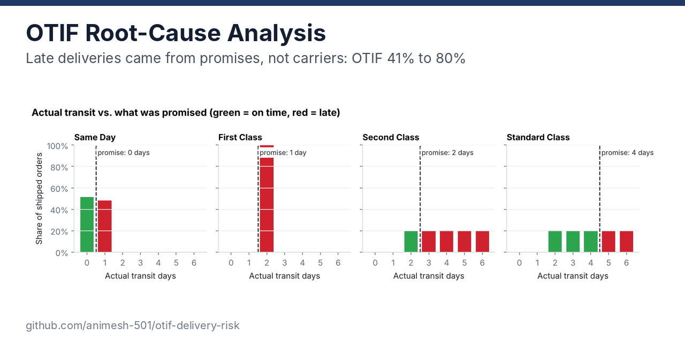
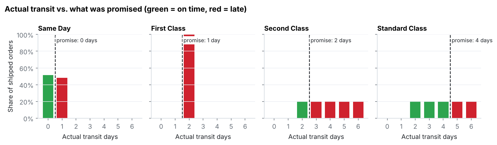
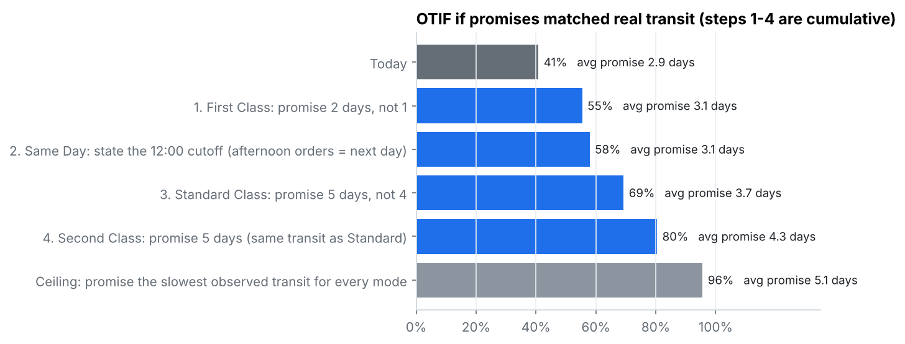
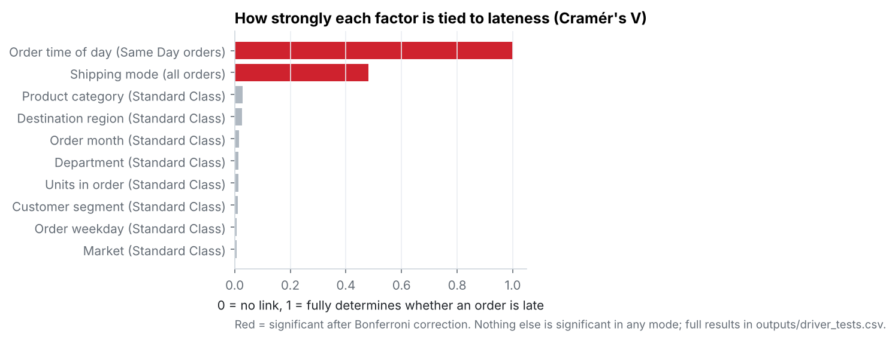
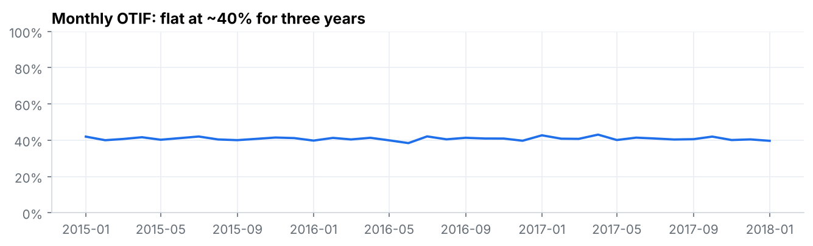

# OTIF Root-Cause Analysis: It's the Promise, Not the Network

**Only 41% of orders arrive on time and in full. Why?** This project tests every likely suspect behind late deliveries across 65,752 orders: region, market, product, customer, timing, order size, and shipping mode. It then works out what fixing the real cause would be worth.



`SQL (DuckDB)` `Python` `pandas` `SciPy` `scikit-learn` `LightGBM` `matplotlib`

---

## Result

**Late deliveries are almost entirely a promise-setting problem.** Transit times barely vary by anything except shipping mode, and each mode's promise is set shorter than the network actually delivers.



| Shipping mode | Share of orders | Promise | Actual transit | OTIF |
|---|---|---|---|---|
| First Class | 15% | 1 day | always 2 days | **0%** |
| Second Class | 19% | 2 days | 2–6 days, evenly spread | **19%** |
| Standard Class | 60% | 4 days | 2–6 days, evenly spread | **58%** |
| Same Day | 5% | 0 days | same day before 12:00, next day after | **49%** |
| **All orders** | | | | **41%** |

**Three findings a planner can act on:**
1. **First Class can never be on time.** Every one of its 10,079 orders took exactly 2 days against a 1-day promise.
2. **Second Class ships no faster than Standard.** Both have the same 2–6 day transit, averaging 4.0 days. Customers paying for the faster service get the same speed as Standard.
3. **Same Day has an unstated noon cutoff.** Orders placed before 12:00 were on time 100% of the time; orders after 12:00 were late 100% of the time.

---

## What it's worth

Holding transit exactly as it is and only changing the promises:



| Change (cumulative) | OTIF | Avg. days promised |
|---|---|---|
| Today | 41% | 2.9 |
| 1. First Class: promise 2 days | 55% | 3.1 |
| 2. Same Day: state the 12:00 cutoff | 58% | 3.1 |
| 3. Standard: promise 5 days | 69% | 3.7 |
| 4. Second Class: promise 5 days, like Standard | **80%** | 4.3 |
| Ceiling: promise the slowest observed transit | 96% | 5.1 |

The ceiling is 96%, not 100%, because 4.3% of orders were cancelled and count as not in full.

**Recommendation**
- **Do steps 1 and 2 now.** Promising First Class at 2 days is honest, since it already takes 2 days every time. Stating the Same Day cutoff costs nothing for morning orders. Together they take OTIF from 41% to 58% with no operational change.
- **Steps 3 and 4 are a commercial call, not an analytics one.** Longer promises can cost conversions. The alternative is fixing transit itself: Standard and Second Class both swing 2–6 days, and that variability is what makes any tight promise unreliable.
- **Review Second Class pricing either way.** As the data stands, it's a paid upgrade with no speed difference.

---

## How I ruled out everything else

**1. Statistical tests within each shipping mode.** If region or product drove lateness, the late rate would differ across them within the same mode. I ran a chi-square test for every factor in every mode where lateness varies (27 tests, Bonferroni-corrected):



Only shipping mode and the Same Day order time are significant. In Standard Class, the largest mode, every other factor has Cramér's V of 0.03 or below. The biggest gap between groups is 10 points across small product categories, which isn't statistically significant.

**2. A model check.** I trained on 2015–2016 orders and tested on 2017 onward:

| Approach | Test AUC |
|---|---|
| Lookup: late rate per shipping mode | 0.743 |
| **Two rules: shipping mode + Same Day noon cutoff** | **0.774** |
| LightGBM with all 14 order-time features | 0.772 |
| LightGBM with the same features, minus shipping mode | 0.510 (coin flip) |

A 14-feature model can't beat two rules. Once shipping mode is removed, nothing left predicts lateness. Only information available when the order is placed was used; actual transit days, delivery status and ship date are outcomes, so they were excluded.

**3. Over time.** OTIF sat flat at about 40% every month for three years, so this is structural, not a bad quarter:



---

## Definitions

- **On time:** actual transit days ≤ promised days.
- **In full:** order not cancelled. The data has no shipped-versus-ordered quantities, so cancellation is the only in-full signal available.
- **OTIF:** on time and in full, measured per order. All lines in an order share the same mode and transit (checked in SQL), so order level is the right grain.
- The source's own `Late_delivery_risk` flag is set to 0 for every cancelled order, even ones that shipped late. Lateness is recomputed from the day counts instead ([`sql/01_quality_checks.sql`](sql/01_quality_checks.sql)).

## Limits

- **The transit times look simulated.** They're perfectly uniform from 2 to 6 days, with identical distributions across 5 markets and 23 regions. Real networks are messier. Treat the specific percentages as a worked example; the method (test the suspects, check the promise against the distribution) is what carries over.
- No carrier, warehouse or route fields exist in the data, so carrier performance can't be tested directly.
- The scenarios assume demand doesn't change when promises do. In reality longer promises may lose some orders.

---

## Run it

```bash
pip install -r requirements.txt
# put DataCoSupplyChainDataset.csv in data/raw/ (see data/README.md)
python run_all.py
```

Runs in under 10 seconds and rebuilds every number and chart. The full console output is in [`outputs/run_log.txt`](outputs/run_log.txt).

```
sql/
  01_quality_checks.sql    duplicates, consistency within orders, late-flag audit
  02_orders.sql            order lines -> one row per order with on-time / in-full / OTIF
  03_otif_kpis.sql         OTIF by mode, by month, transit distribution vs promise
src/
  data.py                  loads the CSV into DuckDB, runs the SQL
  drivers.py               chi-square tests per factor and mode; model vs lookup check
  promise.py               OTIF under alternative promises
  charts.py
outputs/
  summary.csv              headline numbers
  otif_by_mode.csv  otif_by_month.csv  transit_vs_promise.csv
  driver_tests.csv         every test: spread, Cramér's V, raw and corrected p-values
  model_check.csv          AUC and log loss for each approach
  promise_scenarios.csv    on_time_by_promise.csv
```
